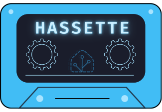

{.hero}

# Hassette

Hassette is a Python framework for writing Home Assistant automations as typed, testable code. It connects to Home Assistant, runs your apps, and shows you what each one is doing.

```python title="apps/motion_lights.py"
--8<-- "pages/getting-started/snippets/landing_motion_lights.py"
```

The light turns on when motion starts. It turns off once the sensor has stayed clear for 120 seconds: `duration` fires the handler only if the new state holds that long, so motion coming back cancels the turn-off.

Each automation is an **app**, a Python class Hassette loads and runs. `on_initialize` runs once when the app starts. `self.bus` subscribes handlers to things that happen in Home Assistant, `self.api` calls services, and `name` labels each subscription in the web UI and CLI. Handlers receive only the parameters they declare, so these two take none. A handler that wants the new state adds a parameter for it; see [Dependency Injection](pages/core-concepts/bus/dependency-injection.md).

App methods are `async def`, and calls to `self.bus`, `self.api` and `self.scheduler` take `await`. That's all the async you need to get started. Not ready for async? [`AppSync`](pages/core-concepts/apps/index.md#synchronous-apps) runs plain synchronous code, with `.sync` versions of the bus, scheduler and API.

`MotionLightsConfig` holds the app's settings as typed fields. Override them in `hassette.toml`, once per room if you like:

```toml
--8<-- "pages/getting-started/snippets/landing_motion_lights.toml"
```

## Why Hassette?

- **Typed state.** Most built-in entity domains have a generated model, so `self.states.light` hands you lights whose `brightness` and `color_temp_kelvin` autocomplete in your editor. Reads come from a local cache, not a round trip to Home Assistant.
- **Filtering built into subscriptions.** Glob patterns (`sensor.*_temperature`), value conditions (`C.Increased()`), debounce and throttle (at most one call per N seconds) are arguments to `on_state_change` and the other subscription methods, so handlers don't start with a block of `if` checks. See [Filtering](pages/core-concepts/bus/filtering.md).
- **Handlers declare their inputs.** Ask for the new state, the old one, or the entity ID in the handler's signature and Hassette passes it in, in the style of FastAPI's dependencies. See [Dependency Injection](pages/core-concepts/bus/dependency-injection.md).
- **Scheduler.** Run a function after a delay, every N minutes, daily at a set time, or on a cron schedule. A job set for 07:00 still runs at 07:00 after the clocks change. See [Scheduler](pages/core-concepts/scheduler/index.md).
- **Test harness.** `AppTestHarness` runs an app without a live Home Assistant: seed states, simulate events, move time forward, and assert which services it called. See [Write Your First Test](pages/testing/index.md).
- **Per-app cache.** Keep data across restarts, with expiry, for things like remembering when you last sent a notification. See [Cache](pages/core-concepts/cache/index.md).
- **Built to keep running.** Hassette reconnects to Home Assistant on its own, reloads apps when you edit them in dev mode, and flags synchronous code that would freeze every other app, naming the app responsible.

## See It in Action

#### Autocomplete for entities and services

Typed models give your editor autocomplete and inline docs for Home Assistant entities, services, and their attributes.

<video class="hero-video" controls autoplay muted loop playsinline>
    <source src="./_static/autocomplete.webm" type="video/webm">
    <source src="./_static/autocomplete.mp4" type="video/mp4">
    Your browser does not support the video tag.
</video>

#### Filtered events, typed handlers

Filters decide which events reach a handler, and the handler's parameters say what data it gets.

<video class="hero-video" controls autoplay muted loop playsinline>
    <source src="./_static/filtered_events.webm" type="video/webm">
    <source src="./_static/filtered_events.mp4" type="video/mp4">
    Your browser does not support the video tag.
</video>

#### Web UI

The web UI runs by default at `http://<host>:8126/`. It shows each app's status and health, the history of every handler and scheduled job down to single executions, live logs, and the resolved configuration. You can start, stop and reload apps and trigger jobs from it. It's protected by a token Hassette generates on first start; the [Web UI docs](pages/web-ui/index.md) show where to find it.


See the [Web UI docs](pages/web-ui/index.md) for a full tour, or the [CLI docs](pages/cli/index.md) for the same information in the terminal.

#### Control apps from Home Assistant

The optional [Hassette integration](pages/getting-started/home-assistant-integration.md), installed through HACS (the Home Assistant Community Store), creates a Home Assistant device for each app. Each device has a switch that starts and stops the app, a reload button, and a status sensor, for your dashboards and automations. It needs Hassette 0.56.0 or newer and Home Assistant 2026.9 or newer.

## Get Started

You need Python 3.11+ and [uv](https://docs.astral.sh/uv/getting-started/installation/).

```bash
--8<-- "pages/getting-started/snippets/install.sh"
```

The [Quickstart](pages/getting-started/index.md) takes you from an empty directory to a running app, including creating the Home Assistant token. To run Hassette in a container, see [Docker Setup](pages/getting-started/docker/index.md). Not sure Hassette fits? Read [Is Hassette Right for You?](pages/getting-started/is-hassette-right-for-you.md)

## Coming from AppDaemon?

Most of what you know carries over: `listen_state` becomes `self.bus.on_state_change`, `call_service` becomes `self.api.call_service`, `run_in` and `run_daily` keep their names on `self.scheduler`, and `self.args` becomes a typed `AppConfig`. What you gain: settings that are checked at startup instead of when a handler fires, a test harness that needs no mocking, and handlers that receive typed data instead of parsing payloads.

Hassette and AppDaemon can run against the same Home Assistant at once, so you can port one app at a time. The [Migration Guide](pages/migration/index.md) walks through each piece, including async basics and a checklist for porting an app.

## Next Steps

- **Local setup:** [Quickstart](pages/getting-started/index.md)
- **Production:** [Docker Setup](pages/getting-started/docker/index.md)
- **How the pieces fit:** [Architecture](pages/core-concepts/index.md)
- **Every setting:** [Configuration](pages/core-concepts/configuration/index.md)
- **Common automations:** [Recipes](pages/recipes/index.md)
- **Migrating from AppDaemon:** [Migration Guide](pages/migration/index.md)
