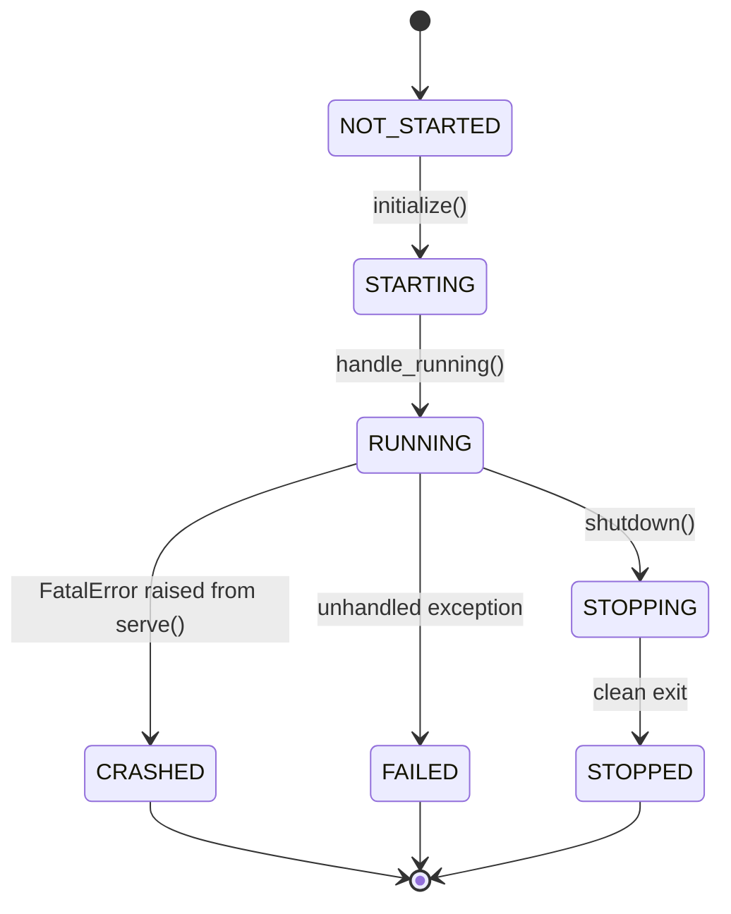

# Resource Lifecycle & Supervision

A [`Resource`][hassette.resources.base.Resource] is any component with a managed lifecycle — Hassette initializes and shuts it down in dependency order. A [`Service`][hassette.resources.service.Service] is a long-running background Resource whose `serve()` loop runs for the life of the process. Hassette never restarts a service in-process. Each service declares whether it is required, and that decides whether its failure ends the process or leaves the service dead in place. This page covers that model, the [service state machine](#resource-state-machine), and readiness signaling.

This page belongs to the [internals section](index.md), written for contributors and advanced users such as authors of custom `Service` subclasses. App authors do not need it to build automations. [Apps — Lifecycle](../apps/lifecycle.md) covers the hooks an app implements.

## Required and Optional Services

Every concrete `Service` subclass declares `required` in its own class body. A class that leaves it out fails with a `TypeError` at class definition.

```python
--8<-- "pages/core-concepts/snippets/internals_service_required.py"
```

**Required** means Hassette cannot usefully run without the service. A required service fails when its `serve()` raises after startup, or returns or is cancelled without anyone asking it to stop. The service ends `FAILED` (`CRASHED` for a [`FatalError`][hassette.exceptions.FatalError]), and Hassette records the reason and shuts down. Hassette also emits a `CRASHED` status event for the service to mark the fatal exit, even when the service's own status is `FAILED`. The process exits with a non-zero code and logs `Hassette terminated due to a fatal error: <reason>` at CRITICAL, for example `service 'BusService' crashed: RuntimeError` or `service 'BusService' serve() ended without shutdown`.

**Optional** means Hassette keeps working without the service. If its `serve()` fails, the service stays `FAILED` (`CRASHED` for a [`FatalError`][hassette.exceptions.FatalError]) — dead in place. Nothing shuts it down or restarts it. Hassette logs one ERROR. For a framework service, the message says a Hassette restart brings it back. For a service an app owns, it says reloading the app does. A `serve()` that simply returns is not a failure: an optional service that returns ends as `STOPPED`.

Only a service whose parent is [`Hassette`][hassette.core.core.Hassette] itself can be required. A service is created by its parent's `add_child()`: `Hassette` adds the framework services, and an app adds its own with `self.add_child(MyWatcher)`. `add_child()` rejects a required service under any other parent, so a service an app owns must declare `required = False`. `Service` itself defaults to `required = True`, which is why a subclass must say which one it means.

| Service | `required` | Notes |
|---|---|---|
| [`BusService`][hassette.core.bus_service.BusService] | `True` | Core event dispatch |
| [`SchedulerService`][hassette.core.scheduler_service.SchedulerService] | `True` | Core job execution |
| `SyncExecutorService` | `True` | Thread pool behind synchronous handlers |
| [`WebsocketService`][hassette.core.websocket_service.WebsocketService] | `True` | Home Assistant outages never reach this, since `serve()` [reconnects in place](../../operating/index.md#websocket-reconnection). The flag covers failures inside Hassette, such as a crash in message handling |
| [`DatabaseService`][hassette.core.database_service.DatabaseService] | `True` | Telemetry and session storage |
| [`CommandExecutor`][hassette.core.command_executor.CommandExecutor] | `True` | Persists handler and job execution records |
| [`WebApiService`][hassette.core.web_api_service.WebApiService] | `True` | HTTP API and UI. It also serves the CLI and `/api/health/live`, so a live process with a dead API would leave automations running with no way to observe them |
| `AppHandler` | `True` | Runs app bootstrap; a failed bootstrap would leave Hassette with no apps |
| `FileWatcherService` | `False` | Config hot-reload |
| `WebUiWatcherService` | `False` | Web UI live-reload |

A failed start at boot is fatal for any service, required or not. Hassette exits and names each failed service with its error. A startup wave doesn't wait on an optional service whose `serve()` has already ended.

!!! warning
    Nothing restarts a crashed service inside the process, so a fatal exit leaves Hassette down unless a restart policy supervises it: the Home Assistant add-on Watchdog, a Docker `restart:` policy, or a systemd `Restart=on-failure` unit. See [Fatal exit](../../web-ui/health-endpoints.md#fatal-exit) for policy examples.

### Where the fatal reason goes

The fatal reason is logged and lands in the supervisor's log: `docker logs`, the add-on log, or `journalctl`. Hassette doesn't read it back at startup, so after a crash loop that log holds the cause. The telemetry session record keeps the reason as `error_message` only; the traceback stays in the log.

### When the event bus dies

`BusService` is required, so its failure takes the same fatal exit as any other required service. Its death also means nothing drains the event channel any more. Before the failure is reported, the bus closes that channel and logs `Event bus stopped unexpectedly; event sends are dropped from now on` at WARNING. From then on, every event sent is dropped instead of waiting for room, including a send that was already waiting when the bus died. The shutdown's own status events are dropped too and never reach a listener, but every resource still moves to `STOPPED`, so shutdown finishes instead of hanging.

The bus closes the channel whenever it stops draining, a clean shutdown included, since nothing could deliver a later event. At boot, a failed startup has the bus close the channel before teardown unless the bus is already draining it.

## Resource State Machine

Every [Resource][hassette.resources.base.Resource] and `Service` tracks its status as a [`ResourceStatus`][hassette.ResourceStatus] value.



The diagram's `CRASHED` state is a resource status, and only a `FatalError` escaping `serve()` sets it. When a required service fails any other way, Hassette still emits a `CRASHED` status event, meaning the failure took the process down, but the service's own status stays `FAILED`.

`NOT_STARTED` is the initial state. `STARTING` covers the period from `initialize()` entry through lifecycle hook execution and child initialization. `RUNNING` is the normal operating state. For services, it persists for the lifetime of the `serve()` loop. `STOPPING` and `STOPPED` represent clean shutdown. `FAILED` means `serve()` ended in failure. A required service in `FAILED` ends the process; an optional one stays `FAILED` until shutdown. `CRASHED` is set when a `FatalError` escapes `serve()`, and for a required service Hassette shuts down. Neither state is ever left by a restart.

## Readiness vs Running

`RUNNING` status and readiness are separate signals. `handle_running()` sets `status = ResourceStatus.RUNNING` and emits a status event. `mark_ready()` sets a readiness `asyncio.Event` that dependents wait on. The framework runs that wait itself, before a dependent's lifecycle hooks fire. App and service code never starts the wait.

A service enters `RUNNING` just before its `serve()` loop begins. Hassette starts that loop only after `after_initialize()` and every child's initialization have finished. A failure before that point fails the initialization attempt. A failure inside `serve()` never does. `initialize()` returns while the service is still `STARTING`. A framework-spawned task then calls `handle_running()` and invokes `serve()` immediately after. A service's children and its `after_initialize()` must not wait on the service's own readiness or `serve()`: the loop starts only after they return. At startup, such a wait times out the startup wave. A service signals readiness by calling `mark_ready()` at whatever internal point it is prepared to serve requests. `WebsocketService` calls `mark_ready()` unconditionally during `on_initialize()`, before it attempts a connection. Lifecycle readiness is decoupled from HA connectivity on purpose. Dependents are never blocked when Home Assistant is unreachable. Connection events never clear readiness. The ready reason (`ready_phase`) carries the connection status instead, such as "Not connected to Home Assistant" or "Home Assistant rejected the access token". `BusService` calls it after the internal event stream is open.

`depends_on` lists the resource types a service waits for before running its own `on_initialize()`. The wait is on readiness, not on `RUNNING` status. A dependent service does not proceed until all declared dependencies have called `mark_ready()`.

| Signal | Set by | Waited on by |
|---|---|---|
| `status = RUNNING` | `handle_running()`, just before `serve()` begins | Nothing (informational only) |
| `ready_event` | `mark_ready()` at service-defined readiness point | Dependents via `depends_on` auto-wait |

## Wave Startup and Shutdown

Hassette starts services in dependency order. `DatabaseService` starts first, on its own, so session tracking exists before anything else runs. Services with no `depends_on` start next. Services that declare `depends_on` start after all their dependencies have signaled readiness. Services at the same dependency depth start concurrently as one wave.

A wave finishes when every member has completed initialization and signaled readiness. Readiness alone isn't enough. `WebApiService` owns a `Scheduler` child that runs the web layer's periodic jobs. It signals readiness inside `on_initialize()`, before that child finishes initializing.

A failed initialization fails startup immediately. Hassette exits and names each failed service with its error. Startup never retries a failed initialization in-process; the process supervisor restarts Hassette instead.

[`startup_timeout_seconds`](../../operating/index.md#startup-and-shutdown-timeouts) in `[hassette.lifecycle]` bounds each whole wave. The `DatabaseService` wave also gets `migration_timeout_seconds` in `[hassette.database]` on top, so a slow migration isn't cut off. A wave that runs past the timeout fails startup the same way. The log lists each unfinished service, its children's statuses, and the line its initialization is waiting on.

Shutdown runs in reverse order. Services that depended on others stop first. A service in `STOPPING` waits for its children to reach terminal states before completing.

For the full dependency graph and startup wave diagram, see [Architecture & Data Flow](index.md).

## Teardown Safety and Restart Refusal

This section is for authors of custom `Service` subclasses. Their shutdown hooks and background
tasks produce the teardown evidence this section describes.

`STOPPED` describes lifecycle *phase*, not proof that a resource's work has actually stopped. A
shutdown hook can fail, a child can time out, a background task can ignore cancellation — and the
resource still reaches `STOPPED`, because `STOPPED` only means lifecycle orchestration finished
running. Restarting an object that reached `STOPPED` without that positive proof risks running old
and new work in the same process at once.

Every completed `shutdown()` call returns a [`ShutdownOutcome`][hassette.resources.shutdown_outcome.ShutdownOutcome].
An outcome is an immutable summary of how the attempt ended. It carries three fields:

- `result`, a [`ShutdownResult`][hassette.resources.shutdown_outcome.ShutdownResult]: `DONE`, `FAILED` (a hook
  or `cleanup()` raised), `TIMED_OUT` (one was cut off at its bound), or `INCOMPLETE` (work may still run).
- `still_running`, the names of tasks still pending when the attempt ended.
- `reason`, one line naming the resource and step behind the result, such as
  `"MyService's shutdown body raised RuntimeError"`. It is `None` for `DONE`.

Its `is_restart_safe` property derives from `result` and `still_running`:

```python
--8<-- "pages/core-concepts/snippets/internals_shutdown_outcome.py"
```

`is_restart_safe` answers one question: may work from this attempt still be running? It's `False`
when anything is named in `still_running`, or when `result` is `INCOMPLETE`. A tracked task, the
`serve()` task, and an initializer that didn't finish being cancelled are named in `still_running`. An
initializer is named by its task name, `resource:initialize:<unique_name>`.

`INCOMPLETE` means the evidence can't rule out running work. The attempt was force-terminated, its
coordinator raised, its shutdown body raised or was cancelled, or a child's shutdown raised. A hook or
`cleanup()` that raised or timed out and has since ended gives `FAILED` or `TIMED_OUT`. That outcome stays
restart-safe, because nothing from it is still running. The property is computed, never stored, so it
can't disagree with the fields.

Outcomes merge up the resource tree. A parent's result is the worst of its own and its children's, in the
order `DONE` < `FAILED` < `TIMED_OUT` < `INCOMPLETE`. Its `still_running` collects every child's names. Its
`reason` is the first one recorded at that worst result. Lesser problems appear only in the logs, which
name each one.

An exception raised outside the shutdown body itself — while observing a pending initializer or
requesting shutdown, for example — also makes the outcome `INCOMPLETE`. The shutdown coordinator (the
single shared task that runs one shutdown attempt for the resource) stores that outcome on
`shutdown_outcome` before re-raising, so `await resource.shutdown()` raises in this case instead of
returning an outcome. `shutdown_outcome` holds the same restart-unsafe outcome a normal completion would
have returned.

### Inspecting an outcome

Python callers read the outcome two ways:

- The **return value** of `await resource.shutdown()` — the exact outcome of that call.
- The **`shutdown_outcome` property** — the current unconsumed outcome, or `None`. An outcome is
  *consumed* when the resource initializes again: a restart-safe outcome is cleared at that point.
  The property is also `None` before any shutdown attempt completes. Prefer the return value when
  history matters; `shutdown_outcome` only reflects the current state.

```python
--8<-- "pages/core-concepts/snippets/internals_shutdown_outcome_inspect.py"
```

The outcome itself has no WebSocket, REST, or dashboard surface; it is a Python-only inspection
point for framework code and embedding hosts. For app instances, a restart-unsafe teardown is what
sets the [needs-restart flag](../../operating/index.md#instances-that-need-a-restart) in the API,
CLI, and web UI.

### Concurrent lifecycle calls join, they don't race

Each resource owns exactly one initialization task and one shutdown task at a time. Every caller
joins that same task through `asyncio.shield()` instead of starting a second attempt; such a caller
is called a *joiner*. Joiners include the background task `start()` spawns to run `initialize()`,
a direct `await resource.initialize()`, and a second concurrent `shutdown()` call.
Cancelling one caller's *wait* (for example, the caller's own task is cancelled) does not cancel
the underlying attempt; the shared task keeps running for every other joiner. A repeated
`shutdown()` call after the attempt has already completed returns the stored outcome without
rerunning any hooks.

If `initialize()` is called while a shutdown is in progress, it waits for that shutdown's outcome
before deciding whether a new attempt may start. If `shutdown()` is called while initialization is
still pending, it cancels and observes that initializer first, then runs shutdown hooks — a
resistant initializer that doesn't finish in time makes the resulting teardown restart-unsafe.

### Restart refusal

This refusal belongs to one resource object. App instances get a separate one: Hassette won't create a
new instance over one flagged as [needing a restart](../../operating/index.md#instances-that-need-a-restart),
and it logs that refusal instead of raising `RestartRefusedError`.

`start()` and a direct `initialize()` call both check the stored outcome before any initialization
work starts. The check runs after the [re-entry check](#lifecycle-re-entry). `start()` checks it
once no initialization or pending start is already in flight; otherwise it returns the
in-flight task. `initialize()` checks it after any in-progress shutdown finishes. An outcome with
`is_restart_safe` `True` authorizes exactly one new attempt and is then cleared. An outcome with `is_restart_safe`
`False` raises [`RestartRefusedError`][hassette.exceptions.RestartRefusedError], which carries the resource's name
and the full outcome as `outcome`, and no initialization work starts. There is no in-process way to clear a
restart-unsafe outcome on the same object, not even a test-reset helper.
Once shutdown fails to prove safety, that object is done recovering on its own.

!!! warning
    Restart refusal cannot stop a coroutine or thread that ignores cancellation — Python
    cancellation is cooperative. Refusal prevents the *same object* from starting a second
    incarnation in the *same process*; it does not, and cannot, guarantee that the process itself
    exits. Process replacement after refusal is the embedding host or supervisor's responsibility
    (systemd, Docker, or equivalent), not something Hassette enforces on its own.

### Lifecycle re-entry

A shutdown hook or initialization hook must not call `initialize()`, `start()`, or
`shutdown()` on the same resource — the hook is running *inside* the very coordinator or body task
those calls would try to join or cancel. Every lifecycle front door checks for this before doing
anything else and raises [`LifecycleReentryError`][hassette.exceptions.LifecycleReentryError] immediately. A
hook that cannot continue should raise or return; it cannot recursively drive its own owner's
lifecycle.

## Next Steps

- [Architecture & Data Flow](index.md): event pipeline, service dependency graph, and component ownership
- [Per-Service Internals](service-details.md): bus routing, scheduler dispatch, database schema, state cache, and web layer
- [Apps — Lifecycle](../apps/lifecycle.md): the initialization and shutdown hooks an app implements
- [Operating Hassette](../../operating/index.md#websocket-reconnection): how the WebSocket reconnects through Home Assistant restarts
