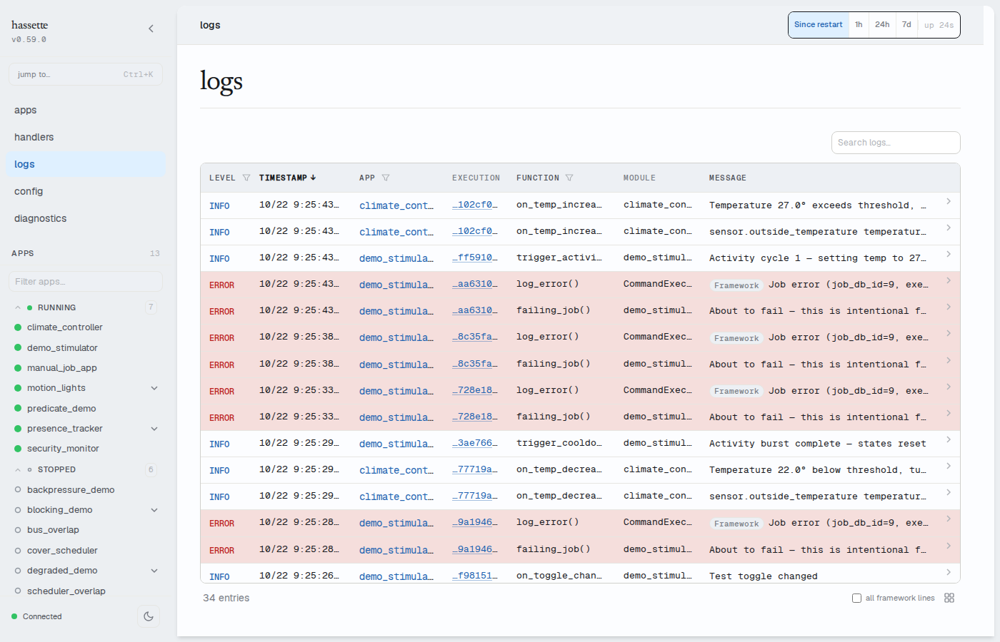
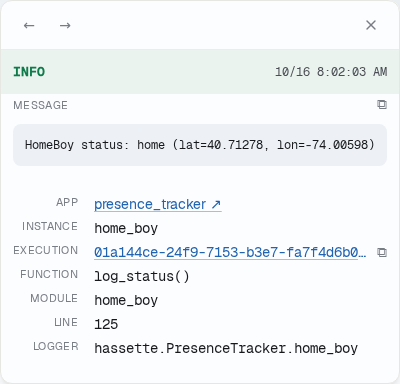

# Read and Filter Logs

The Logs page streams log entries from every app and framework component in real time. Filter and search controls narrow the view to specific entries.

## Filtering and Search

The filter controls narrow the table to specific entries.

**Level** sets the minimum severity shown. It defaults to INFO. Options are: All levels, DEBUG+, INFO+, WARNING+, ERROR+, and CRITICAL only.

**App** narrows the table to one app key.

**Function** filters the function name column by substring. Any part of a function name matches.

**Search** matches against both message content and logger name.

## Hassette's Own Lines

By default, every log view shows app-authored lines plus Hassette's own lines at ERROR and above. Hassette's lines carry a **Framework** badge at the start of the message. That includes lines it writes about an app, such as listener and API activity.

The **all framework lines** checkbox in the table footer adds the rest of Hassette's lines: its DEBUG, INFO and WARNING output. The checkbox is one setting shared by every log view: the Logs page, an app's logs, and an execution's logs. The browser remembers it.

## Entry Count

The footer shows how many entries match. When the result exceeds 200, the footer reads "showing 200 of N". Narrowing the filters surfaces specific entries.

## Trace a Single Execution

Appending `?execution_id=<id>` to the URL filters the table to entries from one handler or job execution. The [Debug Handler](debug-handler.md) page links here automatically from execution history. The URL can also be constructed manually from an execution ID found in logs or the CLI.

When an execution ID filter is active, the other filters use local state. They do not modify the URL, so the execution ID stays intact as the view is refined.

## Log Table Columns

The table is sorted by timestamp descending by default. Sortable columns toggle between descending and ascending on click.

| Column | Sortable | Filterable | Description |
|---|---|---|---|
| Level | Yes | Yes (dropdown) | Severity badge: DEBUG, INFO, WARNING, ERROR, CRITICAL |
| Timestamp | Yes (default desc) | No | Time the entry was recorded |
| App | Yes | Yes (dropdown) | App key, or blank for Hassette's own lines that aren't about an app |
| Instance | No | No | Instance name for multi-instance apps |
| Execution | No | No | Execution ID linking to a handler invocation |
| Function | Yes | Yes (text input) | Python function that emitted the log |
| Module | No | No | Python module name |
| Message | Yes | No | Log message text, with a **Framework** badge on lines Hassette wrote |

## Column Picker

The grid icon in the table footer opens a column picker. Each column has a checkbox to toggle visibility. Level and Message are required and cannot be hidden.

Some columns auto-hide at narrow viewport widths. Those columns appear disabled in the popover with a "Hidden at this screen size" tooltip. They cannot be toggled until the viewport widens. **Reset to defaults** restores the default column set.

!!! note
    The column picker does not appear on mobile viewports. The table uses a compact layout there instead.

## Log Detail Drawer

Clicking any row opens the detail drawer with the complete entry.

The drawer shows a severity badge, full timestamp, and a metadata grid. The grid includes app (linked to its detail page), instance, execution ID, function name, module, line number, and logger name. The execution ID has a copy button.

Below the grid, the full message appears in a scrollable block with a copy button. Entries with exception info show a separate code block beneath the message.

The arrow keys move between entries without closing the drawer. Escape closes it.

On desktop and tablet the drawer opens as a side panel. On mobile it appears as a bottom sheet.

## Live Streaming

New entries appear as they arrive. No refresh needed.

Streaming is active only when the table is sorted by timestamp, the default. Sorting by any other column pauses streaming so incoming entries do not disrupt the sort order. A "paused" button appears in the footer. It resets the sort to timestamp-descending and resumes live updates.

## Related pages

- [Web UI overview](index.md): layout, navigation, and how to enable the UI
- [Debug a Failing Handler](debug-handler.md): execution history with links to filtered logs for each run
- [Database and Telemetry](../core-concepts/database-telemetry.md): how log entries are persisted and retained
