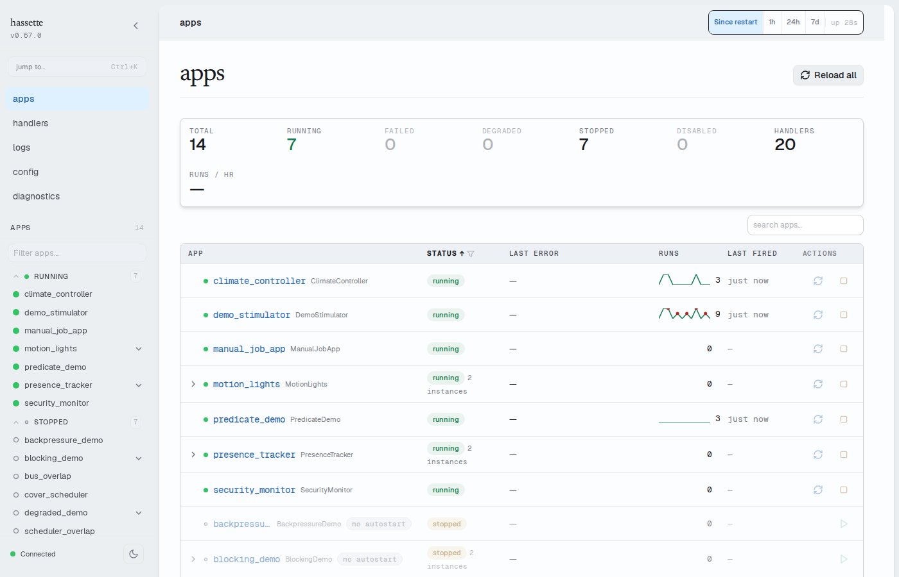
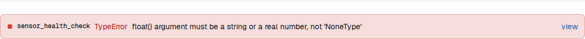
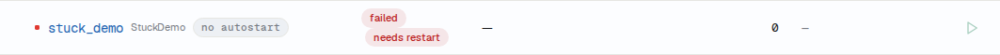
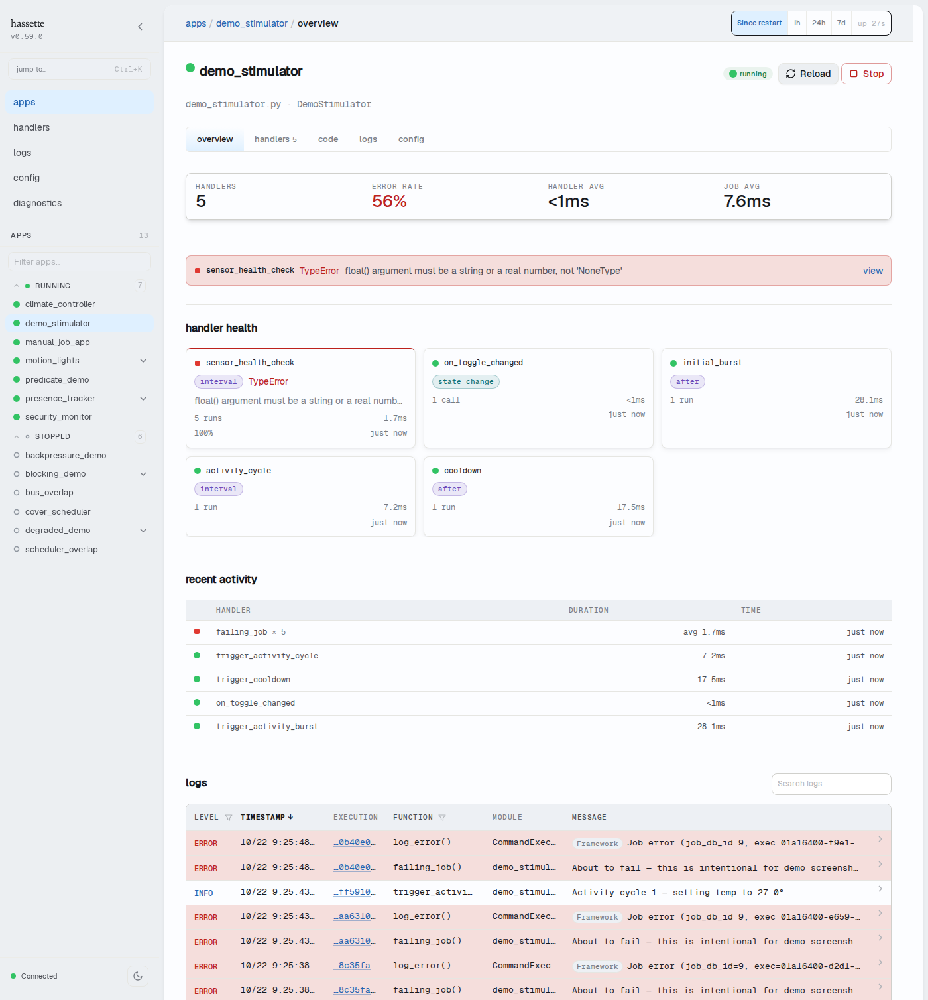
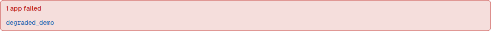

# Manage Apps

The apps dashboard shows every registered automation at a glance: health status, recent errors, and lifecycle controls, all without leaving the browser.

The apps page is the landing page of the web UI. Navigating to `/` redirects to `/apps`.

## Check App Health

The stats strip at the top shows aggregate counts: **TOTAL**, **RUNNING**, **FAILED**, **DEGRADED**, **STOPPED**, **DISABLED**, **HANDLERS**, and **RUNS/HR**. A non-zero **FAILED** or **DEGRADED** count turns that cell red or amber. Zero in both means all automations are fully healthy.

Below the strip, the app table shows one row per app with the following columns:

| Column | What it shows |
|--------|--------------|
| **APP** | Status dot, display name (the app key unless `display_name` is set), and class name. Apps with `autostart = false` also show a **no autostart** chip. |
| **STATUS** | Lifecycle state badge: `RUNNING`, `STOPPED`, `FAILED`, `DEGRADED`, `DISABLED`, or `BLOCKED`. An amber **N blocking** badge follows it when the app [blocked the event loop](../core-concepts/blocking-io-detection.md#finding-blocking-calls) in the selected time window. Click it to see the call sites on the app's overview. The badge is unrelated to the `BLOCKED` status, which comes from `hassette run --app`. A red **needs restart** badge marks an instance whose teardown may have left work running; hover it for the reason. Only restarting Hassette clears it (see [Instances that need a restart](../operating/index.md#instances-that-need-a-restart)). On a multi-instance app the parent row reads **N need restart** when several instances are flagged, or **needs restart** for one, and each flagged instance row carries its own badge. |
| **LAST ERROR** | Most recent error message, truncated. Click to expand the full message. Shows `—` when the app is healthy. |
| **RUNS** | An activity sparkline showing invocation frequency over the selected time window, plus the total run count. |
| **LAST FIRED** | Relative timestamp of the most recent handler or job execution, for example "3 min ago". Shows `—` if the app has never fired. |
| **ACTIONS** | Context-sensitive buttons based on current status. See [Start, Stop, and Reload](#start-stop-and-reload) below. |

Clicking a **LAST ERROR** cell expands the full error message inline:

An instance flagged as needing a restart shows the **needs restart** badge under its status:

### Find a specific app

The search box above the table filters rows by app key and class name as you type. The status filter popover on the **STATUS** column header narrows the table to one lifecycle state. Per-status counts appear in the popover. Searching and status filtering work together.

### Drill into an app

Click an app's name to open the App Detail view. The detail view shows health indicators, a handler list, recent activity, and error details across five tabs.

The strip at the top of the overview shows the instance's health over the selected time window: error rate, average handler duration, and average job duration (skipped job runs aren't included). It reads the same numbers as `hassette app health` for that instance. **Handlers** counts the handlers and jobs registered now.

Health counts every run in the window, including runs of handlers that no longer exist, so an error can show in the error rate without a matching failing row in the handler list.

??? note "Which runs count toward health"
    Health includes runs of handlers and jobs removed since they ran: a `once=True` listener after it fires, a finished `wait_for`, a cancelled subscription, or a removed job. The handler list shows only current registrations, so an error from one of these appears in the health numbers and the Apps table's last error, but not as a failing row. The strip matches the Apps table when only that one instance ran in the window.

### Multi-instance apps

Apps with multiple instances show a parent row with a chevron and an instance count badge (e.g., "2 instances"). Click the chevron to expand into individual instance rows. Each instance row shows its own status dot, badge, last error, and action buttons — Start, Stop, and Reload here target just that instance, not the whole app. Click an instance name to open that instance's detail view, where the header's action buttons target the same single instance.

Clicking the app's own name opens its app-wide overview instead: a card per instance with its status, plus anything that spans instances, such as [blocking calls](../core-concepts/blocking-io-detection.md#finding-blocking-calls) from every instance. Click a card to open that instance's detail view.

The REST API exposes the per-instance start, stop, and reload endpoints backing these buttons (see [Start, Stop, and Reload](#start-stop-and-reload) below) — a sibling instance keeps running untouched when one instance restarts. With automatic reloads on (set [`dev_mode`](../core-concepts/configuration/index.md#development-and-debugging) or [`allow_reload_in_prod`](../core-concepts/configuration/index.md#development-and-debugging) in `hassette.toml`), a config change to just one instance in `hassette.toml` triggers a selective reload: Hassette restarts only the instance whose config changed, not the whole app. Adding or removing an instance works the same way: Hassette creates the new instance or stops the removed one, and the other instances keep running. See [Passing Configuration](../core-concepts/apps/configuration.md#multiple-instances) for the config side of this behavior.

## Start, Stop, and Reload

Action buttons appear in the **ACTIONS** column and in the App Detail header. Which buttons appear depends on the app's current status:

| Button | Available when | What it does |
|--------|---------------|-------------|
| **Start** | `STOPPED`, `FAILED`, or `DISABLED` | Initializes the app and begins processing events. |
| **Stop** | `RUNNING` or `DEGRADED` | Shuts the app down gracefully and cancels its scheduled jobs. The app stops receiving events until started again. |
| **Reload** | `RUNNING` or `DEGRADED` | Stops the app and starts it again without restarting the Hassette process. Re-imports the app's own module file first if it changed or its last import failed. See [What Reload Re-imports](#what-reload-re-imports). |

**Stop** and **Reload** are both available for `DEGRADED` apps, not just `RUNNING` ones — a degraded app still has at least one instance running, so shutting it down or picking up new code is a meaningful recovery action. **Start** is not: nothing about `DEGRADED` implies a fully stopped app.

**Start**, **Stop** and **Reload** skip an instance flagged as [needing a restart](../operating/index.md#instances-that-need-a-restart). Its siblings still start, stop or reload. The action's error message names the flagged instance and says to restart Hassette.

An action finishes before it answers. When it fails on one instance, the error message names that instance with its failure, after a count of the instances it acted on.

**Reload** picks up changes to the app's own module file only. It keeps the app's config as Hassette last loaded it, so an edit to an app's config in `hassette.toml` needs [Reload all](#reload-all) or a Hassette restart. With automatic reloads on (set [`dev_mode`](../core-concepts/configuration/index.md#development-and-debugging) or [`allow_reload_in_prod`](../core-concepts/configuration/index.md#development-and-debugging) in `hassette.toml`), Hassette reloads the config and the affected apps on its own when you save. Reloading one app does not affect other running apps.

These actions call the REST API — `POST /api/apps/{key}/start`, `/stop`, `/reload` for the whole app, or `POST /api/apps/{key}/instances/{instance_name}/start`, `/stop`, `/reload` for a single instance. The CLI exposes the same three actions as `hassette app start|stop|reload`, with `--instance` routing to the per-instance endpoint. See [CLI Commands](../cli/commands.md) for the full command reference.

### Reload All

**Reload all**, in the Apps page header, reloads every app from disk without restarting the Hassette process. The Home Assistant connection and the state cache stay up, so a deploy that changes shared helpers no longer leaves a gap with no listeners while the container restarts. After you confirm it, Hassette:

1. Re-reads `hassette.toml` for the app configuration: which apps exist, their settings, and the `--app` filter. Settings outside the apps, such as the Home Assistant URL, the log level or the web API's, need a Hassette restart to take effect.
2. Checks every Python file it is about to import for syntax errors.
3. Stops every app that is running or `FAILED`.
4. Forgets every module loaded from your app directories, helpers included.
5. Starts those apps again, so each one imports the current code.

It also stops apps the new config removed or disabled, and starts apps it added (unless they have `autostart = false`). An app you stopped by hand stays stopped, and it imports the new code when you start it. While the reload runs, starting or reloading a single app answers that a reload is still running; try again once it finishes.

Reload all refuses, and stops nothing, when:

- `hassette.toml` is invalid. The message names each error.
- A file it would import has a syntax error. The message gives the file, relative to its app directory, and the line: `helpers/notify.py:12: invalid syntax`.
- Another reload, or an action on one of the apps it restarts, is still running.

Once it has run, a toast says how many apps it reloaded, stopped and started, gives the number that succeeded, failed and were refused, and names each app that didn't succeed. If the request itself fails without an answer from Hassette, such as a proxy timeout, the toast says the reload may not have finished: check the app list for each app's status. An app whose import fails for any reason other than a syntax error, such as an `ImportError`, ends up `FAILED` with the error as its last error. The other apps still start.

The same action is `POST /api/apps/reload` in the REST API and `hassette app reload --all` in the CLI. The API answers 200 whenever the reload ran, even if some apps failed; read `counts.failed` and `counts.refused` in the response. Each app in it carries an `action`: `reload`, `stop` (the config removed it) or `start` (the config added it). A refusal answers 409 with the code `reload_config_invalid`, `reload_syntax_error` or `action_in_progress` (see [API Errors](api-errors.md)). `?wait=true` waits for a running reload or app action to finish instead of answering 409. The web UI never waits.

### What Reload Re-imports

What a reload picks up depends on what triggered it:

- **The Reload button, `hassette app reload`, the Home Assistant reload button, or saving the app's own file** (with automatic reloads on): Hassette re-imports the app's own module file. Every module that file imports, such as a sibling module in a package-style app or a shared helper, keeps its previously imported code.

    Hassette re-imports the file only when its contents changed since the last successful import, or when that import failed. Reloading an unchanged file restarts the app on the code already loaded, so the file's top-level code doesn't run again. Two apps defined in one file share one import, so reloading both after an edit runs the file once.

    Reloading a single instance (the instance's Reload button, or `hassette app reload --instance`) while sibling instances run restarts it on the siblings' code. Every instance of an app runs the same code. Reload the whole app to pick up an edit.

    A re-import replaces the module with a new copy. Another app module that imported it whole (`import apps.helpers as helpers`) keeps calling the old copy until that app reloads too. Names imported with `from apps.helpers import notify` keep the old code either way.
- **Saving a change to the app's `app_config` in `hassette.toml`**: Hassette restarts the affected instances, usually only the ones whose config changed, with the code it already has loaded. Nothing is re-imported.
- **[Reload all](#reload-all)**, or (with automatic reloads on) **saving any other Python file in an app directory**, such as a sibling module or a shared helper: Hassette forgets every module loaded from your app directories and restarts every running or failed app, so every app imports the current code. Saving an app's own file does the same when another app imports that file, so the two apps stay on the same version of it.

!!! warning "Edits outside the app's own file need Reload all"
    Take an app at `garage_proximity/app.py` that imports `garage_proximity/models.py`. Reloading just that app never re-reads `models.py`, which causes two failures:

    - **The reload fails.** Add `NewThing` to `models.py` and `from .models import NewThing` to `app.py`, then reload the app. The import raises `ImportError: cannot import name 'NewThing'`. Hassette stopped the app before re-importing, so the app stays stopped with status `FAILED`. The `ImportError` appears in the log and as the app's last error.
    - **The reload succeeds with old code.** Change only how something in `models.py` behaves, then reload the app. The reload reports no error, and the app keeps running the old `models.py` code.

    Use **Reload all** (or `hassette app reload --all`) whenever anything other than the app's own file changed. With automatic reloads on, saving `models.py` runs it for you.

Reload all has limits of its own:

- **Module-level code runs again.** Each app module and helper is imported fresh, so code at the top level of a file runs on every Reload all. A helper that starts a thread, opens a session or registers an `atexit` hook at import time does it again, and the copy from the previous import isn't cleaned up. Do that work in an app's `on_initialize` instead, where `on_shutdown` can undo it.
- **Dynamic imports aren't seen by the file watcher.** The watcher reads `import` statements to tell whether a saved app file is imported by another app. An app that loads another with `importlib.import_module` isn't counted, so saving the imported file reloads only that app. Run Reload all by hand in that case.
- **Code outside your app directories stays loaded.** Installed packages, including a copy of your own package installed with `pip`, keep the code from their first import. Restart Hassette after upgrading one.

## Understand App States

The **STATUS** badge on each row reflects the app's current lifecycle state. When more than one applies, the first in this table wins.

| State | Meaning |
|-------|---------|
| `DISABLED` | The app has `enabled = false` in `hassette.toml`. **Start** runs its instances for this session, but the app's badge still reads `DISABLED`. Setting `enabled = true` in config makes the change permanent. |
| `BLOCKED` | Hassette is restricted to a different set of apps via [`hassette run --app <key>`](../core-concepts/apps/index.md#restricting-which-apps-run), so this app is excluded. The block lasts for the life of the process. |
| `DEGRADED` | A multi-instance app has at least one failed instance and at least one that is still running, starting or stopping. The app is partially working — check which instance failed in the [Multi-instance apps](#multi-instance-apps) view above. |
| `FAILED` | The app encountered an unhandled error. Check the **LAST ERROR** column or the App Detail error banner for the traceback. |
| `STARTING` | An instance is starting up (running its `on_initialize`). A multi-instance app shows this while any one instance restarts. |
| `STOPPING` | An instance is shutting down. A multi-instance app shows this while any one instance stops. |
| `RUNNING` | The app is processing events normally. |
| `STOPPED` | The app was stopped via the UI or REST API, or it has `autostart = false` and has not been started yet. It will not process events until started. Apps with `autostart = false` show a **no autostart** chip in the APP column. |

An individual *instance* row (inside a [multi-instance app](#multi-instance-apps)) carries its own status. `STARTING` and `STOPPING` apps aren't counted in the stats strip above the table, and no filter chip selects them, so they show only under **all**.

A row for an app with `autostart = false`. The app stays `STOPPED` until started on demand, and the **no autostart** chip in the APP column marks why.

A `DEGRADED` app also appears in the [failed apps alert banner](index.md#layout) alongside apps that are fully `FAILED` — a partially working app still needs attention.

For the full lifecycle state machine and transition rules, see [Apps lifecycle](../core-concepts/apps/lifecycle.md).
